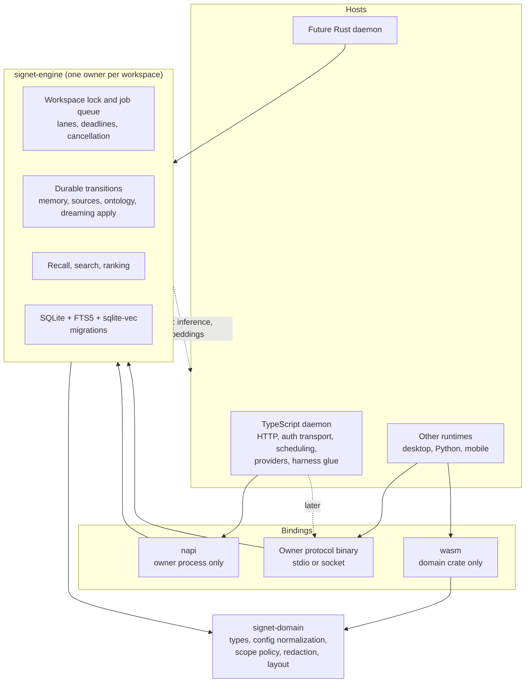

# Rust Core Map

This map covers the move of Signet's core logic into a Rust engine that
several runtimes can host. The TypeScript daemon stays as the first host.
A Rust daemon comes later and is out of scope here; the engine API is
shaped so that daemon can link it directly.

Measured at `d24d12faf` on 2026-11-04. Methods:

- Lines are non-blank lines in tracked, non-test TypeScript files.
- SQL sites are string literals that open with a SQL keyword (`SELECT`,
  `INSERT`, `UPDATE`, `DELETE`, `WITH`, `CREATE`, `PRAGMA`, `REPLACE`,
  `DROP`, `ALTER`). This is a count of statements, not of call sites.
- The owner closure is every daemon file in the `bun build` metafile for
  `platform/daemon/src/db-owner-worker.ts`. A file can sit in the closure
  and also be loaded by the request-serving process.
- Consumers are non-test imports from `@signet/core`, resolved through
  `platform/core/src/index.ts` and the package's subpath exports.

## Target shape

The engine never calls a model. When it needs one, it returns an effect
(for example, "inference needed for this request"), the host performs the
call, and the result goes back in. Dreaming planning, validation and apply
live in the engine; each host supplies only the model call.

## Findings

1. Most of what we'd call core logic is in the daemon, not in
   `@signet/core`. The core package has about 14,600 lines. Only about
   1,700 of them, plus the migrations, are engine material. About 58,000
   daemon lines are engine material, and another 26,000 split between
   engine and host.
2. Migrations dominate the PR 1 core work: 171 migration files and about
   7,600 lines, at schema version 171, with roughly two new migrations a
   week landing on main (9 in the last 30 days).
3. The daemon sends SQL across the owner protocol. 943 of its 1,807 SQL
   statement sites sit in 102 files outside the owner closure, and route
   files alone hold 149. Each one is a transition that still has to move
   into a typed engine operation. This count is the progress meter for
   phase 2.
4. The CLI opens the workspace database directly in six commands
   (`vector`, `portable`, `daemon`, `setup-migrate`, `health`,
   `workspace-protection`; `setup-fresh` only checks that the file exists),
   through `surfaces/cli/src/sqlite.ts`. Several open it writable. The
   database integrity checker also opens it from its own child process.
   These openers have to go through the engine (the running owner, or an
   engine instance holding the workspace lock) before the engine's lock
   can be the single-owner guarantee.
5. Six core files have no in-repo consumers outside core: the old
   portable-identity `Signet` class and its parsers (`signet`, `memory`,
   `manifest`, `soul`), the ChatGPT/Claude/Gemini export `migrate`, and
   `git-archive-retirement`. They are still public exports, so removing
   them is an explicit API decision, not cleanup.
6. Integrations import only small, mostly pure pieces of core: identity
   paths, constants, `spawnHidden`, recall row types, memory-context
   fencing, daemon URL. Leaving those in TypeScript, or moving them to a
   wasm build of the domain crate later, keeps native binaries out of
   harness processes.

## Dispositions

- **PR 1: engine.** Replaced by the Rust engine in the first PR. The TS
  implementation is deleted at cutover.
- **engine.** Moves into `signet-engine` in a phase 2 PR. Each PR deletes
  the TS implementation it replaces.
- **split.** Durable state and transition logic move to the engine.
  Scheduling, IO, model calls and transport stay in the host.
- **domain.** Pure logic for `signet-domain`. Moves when a second runtime
  or the engine needs it; the TS copy is deleted when it moves.
- **host.** Stays TypeScript until the Rust daemon. Not part of this
  effort.
- **retire review.** No in-repo consumers. Needs a public-API decision.

## @signet/core

### PR 1: engine (6 files, 1,672 lines)

| File | Lines | Runtime | External consumers (non-test) |
|---|---:|---|---|
| `migration.ts` | 486 | pure | daemon 1, cli 5 |
| `database.ts` | 468 | sqlite,fs,os | daemon 3, cli 3 |
| `search.ts` | 455 | pure | daemon 14 |
| `fts-schema.ts` | 183 | pure | daemon 4 |
| `sqlite-journal.ts` | 66 | fs | daemon 1 |
| `memory-provenance.ts` | 14 | pure | none |

### signet-domain, later (22 files, 5,572 lines)

| File | Lines | Runtime | External consumers (non-test) |
|---|---:|---|---|
| `routing.ts` | 1363 | pure | daemon 7, cli 1 |
| `sources-config.ts` | 1222 | fs,os,crypto | daemon 18, cli 3 |
| `types.ts` | 925 | pure | daemon 36, observer-belief-eval.ts 1, cli 1 |
| `recall.ts` | 487 | pure | openclaw 1, opencode 1, pi 1, sdk 2, daemon 7, cli 1 |
| `memory-context.ts` | 213 | pure | openclaw 1, opencode 1, pi 2, daemon 3 |
| `protection.ts` | 179 | pure | daemon 1, cli 1, dashboard 1 |
| `workspace-layout.ts` | 177 | fs | daemon 30, cli 16, desktop 1 |
| `yaml.ts` | 151 | fs,crypto | daemon 10, cli 11 |
| `transcript-export.ts` | 114 | pure | daemon 1 |
| `llm-model-catalog.ts` | 109 | pure | daemon 2 |
| `markdown.ts` | 98 | pure | connector-base 1, daemon 1 |
| `credential-detection.ts` | 92 | pure | pi 1, daemon 30 |
| `connector-types.ts` | 91 | pure | daemon 3 |
| `skill-transcript.ts` | 89 | pure | daemon 1 |
| `prompt-context.ts` | 84 | crypto | opencode 1, daemon 2 |
| `source-substrate.ts` | 62 | pure | daemon 12 |
| `pipeline-providers.ts` | 34 | pure | opencode 1, daemon 2, cli 1 |
| `constants.ts` | 31 | fs,os | claude-code 1, codex 1, forge 1, gemini 1, hermes-agent 1, kimi 1, muse-code 1, oh-my-pi 1, openclaw 1, opencode 1, connector-base 1, daemon 27, cli 1 |
| `daemon-runtime.ts` | 29 | pure | daemon 3, cli 2 |
| `plugins.ts` | 12 | pure | daemon 4, cli 2 |
| `ontology-topology.ts` | 6 | pure | daemon 4 |
| `telemetry-config.ts` | 4 | pure | daemon 1, cli 1 |

### stays TS (28 files, 6,859 lines)

| File | Lines | Runtime | External consumers (non-test) |
|---|---:|---|---|
| `workspace-source-repo.ts` | 1195 | fs,process | daemon 2, cli 3 |
| `secrets.ts` | 1072 | fs,process,os,crypto | daemon 1, cli 1 |
| `index.ts` | 707 | process | none |
| `identity.ts` | 358 | fs,os | claude-code 1, codex 1, forge 1, gemini 1, hermes-agent 1, kimi 1, muse-code 1, oh-my-pi 1, openclaw 1, opencode 2, pi 2, daemon 4, cli 8 |
| `export.ts` | 330 | fs | cli 1 |
| `secrets-keyring.ts` | 281 | fs,process,crypto | daemon 1, cli 1 |
| `package-manager.ts` | 275 | fs,os | daemon 4, cli 4 |
| `import.ts` | 257 | fs | cli 1 |
| `workspace.ts` | 243 | fs,os,crypto | openclaw 1, opencode 1, connector-base 1, daemon 7, cli 4, desktop 1 |
| `signet-installation.ts` | 204 | fs,os | daemon 2, cli 3 |
| `skills.ts` | 200 | fs,os | cli 1 |
| `graphiq.ts` | 194 | fs,os | daemon 3, cli 4 |
| `gitignore.ts` | 180 | pure | daemon 1, cli 1 |
| `secrets-keyring-child.ts` | 169 | keyring | none |
| `identity-spec.ts` | 142 | pure | none |
| `protection-evidence.ts` | 142 | fs,crypto | daemon 1 |
| `launchd.ts` | 125 | fs,os | daemon 3, cli 2, desktop 1 |
| `agents.ts` | 115 | fs | daemon 12, cli 2 |
| `symlinks.ts` | 112 | fs | connector-base 1 |
| `git-transition.ts` | 97 | fs | daemon 1 |
| `child-process.ts` | 89 | process | claude-code 1, codex 1, hermes-agent 1, daemon 19, cli 15, desktop 2 |
| `pipeline-pause.ts` | 84 | fs | daemon 2, cli 2 |
| `daemon-url.ts` | 77 | pure | kimi 1, connector-base 1, sdk 2, daemon 2, cli 2 |
| `package-manager-path.ts` | 74 | os | none |
| `assistant-chat.ts` | 55 | pure | daemon 2, dashboard 1 |
| `network.ts` | 40 | pure | openclaw 1, daemon 3, cli 8, desktop 1 |
| `harness-config.ts` | 33 | fs | daemon 2, cli 2 |
| `secrets-key.ts` | 9 | pure | none |

### retire review (6 files, 457 lines)

| File | Lines | Runtime | External consumers (non-test) |
|---|---:|---|---|
| `git-archive-retirement.ts` | 198 | fs,os,crypto | none |
| `signet.ts` | 85 | fs | none |
| `memory.ts` | 81 | pure | none |
| `migrate.ts` | 37 | pure | none |
| `soul.ts` | 34 | pure | none |
| `manifest.ts` | 22 | pure | none |

Migrations (`platform/core/src/migrations/`): 171 migration files plus
`index.ts` and `contract.ts`, about 7,600 lines, latest version 171.
Disposition: PR 1. Fresh installs build from a Rust baseline schema;
existing databases are supported from a minimum version chosen before
PR 1 starts; migrations after the baseline are ported. A CI check
compares the normalized `sqlite_schema` produced by both sides so
migrations landing on main during PR 1 can't drift silently.

`types.ts` is listed under domain, but its row and schema types become
generated output from the Rust types rather than a hand port.

## Daemon

`platform/daemon/src` by domain. Lines in the owner closure show how much
of each domain already runs behind the owner boundary.

| Domain | Disposition | Files | Lines | SQL sites | Routes | Lines in owner closure |
|---|---|---:|---:|---:|---:|---:|
| HTTP, MCP and hook surface | host | 50 | 27,680 | 149 | 345 | 326 |
| Inference and model providers | host (effect) | 27 | 7,603 | 0 | 0 | 6,748 |
| Source providers and capture | host | 38 | 13,117 | 100 | 0 | 1 |
| Harness, plugins, secrets | host | 20 | 4,166 | 4 | 0 | 1,677 |
| DB owner, storage runtime, integrity | PR1 boundary / engine | 32 | 15,200 | 236 | 0 | 8,740 |
| Embedding and vector index state | engine | 13 | 4,771 | 174 | 0 | 1,719 |
| Memory writes, lineage, heads | engine | 18 | 5,573 | 131 | 0 | 4,122 |
| Recall, search, ranking, context assembly | engine | 33 | 12,561 | 160 | 0 | 7,743 |
| Ontology and knowledge graph | engine | 23 | 11,430 | 239 | 0 | 7,484 |
| Dreaming | split (engine plans/applies, host runs model) | 23 | 11,305 | 147 | 0 | 10,189 |
| Pipeline workers | split (durable logic engine, scheduling host) | 13 | 4,397 | 86 | 0 | 0 |
| Source lifecycle and transcript store | engine | 23 | 8,394 | 207 | 0 | 3,096 |
| Agents, cross-agent, board | split | 12 | 4,460 | 63 | 0 | 30 |
| Auth and authorization | split (policy domain, transport host) | 10 | 952 | 6 | 0 | 952 |
| Config normalization | domain | 3 | 1,691 | 0 | 0 | 1,052 |
| Telemetry and diagnostics | split | 14 | 5,150 | 91 | 0 | 3,419 |
| Daemon lifecycle and ops | host | 24 | 7,836 | 14 | 1 | 901 |
| Total | | 376 | 146,286 | 1807 | 346 | 58,199 |

## Owner protocol operations

`DbOwnerRequest` in `platform/daemon/src/db-owner-protocol.ts` has 40
kinds. In PR 1 the Rust engine implements the executor and lifecycle
kinds natively. The semantic kinds keep their TS implementations inside
the owner process, running on the Rust-owned connection, until their
phase 2 PR moves them.

| Group | Kinds | Moves in |
|---|---|---|
| Executor and lifecycle | `initialize`, `query`, `transaction`, `batch`, `health_ready`, `diagnostics`, `sleep` | PR 1 (`query`, `transaction` and `batch` are deleted at the end of phase 2) |
| Memory | `memory_head`, `agent_remove` | Memory writes |
| Recall and vectors | `recall`, `vector_search`, `vector_repair`, `vector_backfill`, `embedding_migration_progress` | Recall; embedding index |
| Sources and transcripts | `source_snapshot_import`, `source_graph_index`, `source_graph_file_purge`, `source_graph_purge`, `source_purge`, `source_artifact_index`, `source_native_memory_index`, `source_artifact_purge`, `source_artifact_upsert`, `source_artifact_upsert_batch`, `source_evidence_eligibility`, `transcript_bulk_commit` | Sources |
| Dreaming | `dreaming_hygiene_attention`, `dreaming_surprisal_attention`, `dreaming_episodic_backlog`, `dreaming_episodic_backlog_probe`, `dreaming_episodic_backlog_exists`, `dreaming_evidence_search`, `dreaming_evidence_source`, `dreaming_evidence_review`, `dreaming_pass_finalize`, `dreaming_review_due`, `dreaming_evidence_classify`, `dreaming_evidence_requeue` | Dreaming |
| Maintenance | `vacuum_conversion`, `incremental_vacuum` | Storage runtime |

## Sequence

PR 1 is one branch and one PR, cut over once it's proven. Everything
after it is a separate PR, and each one fully cuts over its slice: the
TS implementation is deleted in the same change, so there is never a
second executor for any transition.

| Step | Scope | Daemon domains | Done when |
|---|---|---|---|
| PR 1 | Engine foundation: connection, lock, executor, migrations, search, napi binding inside the owner | DB owner (connection and executor only) | Owner runs on the Rust connection; core SQLite adapter and TS migration runner deleted; schema byte-identical so rollback is a reinstall |
| 2.1 | Direct database openers | CLI commands, integrity checker | Nothing outside the engine opens the workspace database |
| 2.2 | Memory writes | Memory writes, lineage, heads | Remember, supersede, lineage, heads and agent removal are engine operations |
| 2.3 | Recall | Recall, search, ranking, context assembly | Recall and search run in the engine; host only formats |
| 2.4 | Sources | Source lifecycle and transcript store | Source and transcript transitions are engine operations; providers only fetch |
| 2.5 | Ontology | Ontology and knowledge graph | Claims, aspects, proposals and graph queries run in the engine |
| 2.6 | Dreaming | Dreaming | Engine plans, validates and applies; host supplies the model call through effects |
| 2.7 | Embedding index | Embedding and vector index state | Index state, migration and repair are engine-owned; fetch stays a host effect |
| 2.8 | Split domains | Pipeline workers, agents and board, telemetry storage, auth policy, config normalization | Durable parts in the engine or domain crate; scheduling and transport in the host |
| 2.9 | Raw SQL removal | Routes and all remaining callers | No daemon file sends SQL; `query`, `transaction` and `batch` are deleted |
| 2.10 | Protocol binary | Owner process | The TS owner worker is replaced by the engine's protocol binary |

Memory writes come before ontology and dreaming because both depend on
them. Dreaming comes last among the large domains because it depends on
memory, ontology and the effects interface.

## Open decisions

1. The minimum supported schema version for PR 1.
2. The first non-TypeScript host. It decides whether embedding bindings
   or only the protocol binary are needed early.
3. Whether to remove the retire-review exports, and how to announce it.
4. How CLI commands that run while the daemon is stopped reach the
   engine: start an engine instance that takes the workspace lock, or
   require the daemon.
5. The effect interface for inference and embeddings: request and
   response shapes, cancellation, and deadlines.

The counts above are a snapshot at `d24d12faf`. The repository doesn't
have a generator for them yet.

## Appendix: daemon files by domain

`name lines[/N sql]`, with `*` marking files in the owner closure.

### HTTP, MCP and hook surface: host

`routes/memory-routes` 3723/60sql, `mcp/tools` 2223/1sql, `hooks` 2126/2sql, `routes/hooks-routes` 2078/8sql, `routes/inference` 1934, `routes/sources-routes` 1702/16sql, `routes/skills` 1063, `routes/pipeline-routes` 1022/2sql, `routes/repair-routes` 934/8sql, `routes/git-sync` 922, `routes/ontology-routes` 853, `routes/utils` 818/4sql, `routes/telemetry-routes` 784/3sql, `routes/knowledge-routes` 563/4sql, `routes/transcript-import-routes` 509/9sql, `routes/secrets-routes` 493, `routes/misc-routes` 484/8sql, `routes/session-routes` 473/4sql, `routes/state` 457, `routes/connectors-routes` 393/3sql, `routes/marketplace-reviews` 380, `routes/board-routes` 338/1sql, `routes/health` 328/1sql, `sse-stream` 326*, `routes/database-diagnostics` 298/7sql, `routes/auth-routes` 284, `routes/graphiq-routes` 232, `routes/reflection-routes` 230/5sql, `routes/queue-diagnostics` 204, `routes/changelog` 194, `routes/harness-install` 194, `routes/import-routes` 193, `mcp/route` 161, `routes/skill-analytics` 119/3sql, `routes/plugins-routes` 93, `routes/dashboard` 86, `routes/git-config` 83, `mcp-stdio-runtime` 69, `middleware` 56, `routes/dashboard-identity` 54, `bind-with-retry` 53, `request-scope` 45, `mcp/dreaming-tools` 41, `routes/graphiq-install-path` 16, `bun-socket-polyfill` 15, `internal-fetch` 13, `http-server` 10, `mcp-stdio` 5, `mcp-stdio-url` 4, `mcp/index` 2

### Inference and model providers: host (effect)

`inference-router` 1738*, `pipeline/provider` 1524*, `pipeline/pi-provider` 748*, `embedding-fetch` 648*, `embedding-worker` 469, `embedding-worker-handle` 398*, `inference-oauth` 391*, `pipeline/pi-agent-client` 345*, `native-embedding` 250*, `pipeline/pi-agent-worker` 166, `native-rerank` 131*, `pipeline/reranker-llm` 118*, `inference-provider-factory` 110*, `local-context-window` 93*, `embedding-circuit-breaker` 78*, `pipeline/reranker-cross-encoder` 66*, `cross-encoder-buckets` 62, `pipeline/pi-agent-protocol` 56*, `llm` 49*, `pipeline/model-registry` 48, `embedding-worker-protocol` 42, `pipeline/dreaming-token-worker` 42, `embedding-wasm-config` 24, `inference-oauth-runtime` 4*, `llm-concurrency-limits` 1*, `shims/sharp` 1, `transformers-runtime` 1

### Source providers and capture: host

`discord-source-provider` 1588/6sql, `discord-desktop-cache-source` 1276/2sql, `transcript-capture-worker` 841/15sql, `notion-source-provider` 729/7sql, `web-source-provider` 710/4sql, `github-source-fetch` 671, `transcript-recovery-worker` 670/6sql, `obsidian-source-embeddings` 604/25sql, `native-memory-source-worker` 537, `github-source-provider` 530/3sql, `discord-gateway-tail` 513, `discord-source-fetch` 498, `connectors/filesystem` 460/3sql, `transcript-import-bytes` 410/17sql, `notion-source-fetch` 399, `transcript-import-worker` 314/3sql, `document-import-service` 251, `transcript-import-safe-fs` 244, `import-normalizer` 220, `import-inbox` 212, `pipeline/url-fetcher` 187, `watcher-ignore` 185, `source-index-progress` 174, `manual-inbox-worker` 165, `connectors/registry` 98/9sql, `transcript-capture` 97, `transcript-import-scan` 95, `source-providers` 77, `transcript-import-admission` 71, `skill-transcript-scan` 70, `transcript-recovery-supervisor` 64, `url-validation` 49, `transcript-recovery-child` 36, `source-deletion-lock` 27, `file-sync` 22, `transcript-import-operation-lock` 19, `pipeline/url` 3, `native-memory-constants` 1*

### Harness, plugins, secrets: host

`plugins/host` 476, `bitwarden` 425*, `onepassword` 396*, `secrets` 381*, `hooks-config` 320, `plugins/bundled/secrets` 297/3sql*, `harness-registry` 235, `plugins/bundled/graphiq` 207, `cross-agent-acp` 206, `identity-context` 178, `plugins/audit` 178*, `plugins/types` 171/1sql, `harness-health` 160, `graphiq` 109, `plugins/manifest` 109, `identity-sync` 100, `harness-install-worker` 85, `plugins/index` 66, `harness-health-worker` 34, `harness-python` 33

### DB owner, storage runtime, integrity: PR1 boundary / engine

`repair-actions` 3087/58sql, `db-accessor` 2551/31sql*, `db-owner-worker` 1324/16sql*, `db-owner-maintenance` 1121/35sql*, `incremental-database-integrity` 971/26sql, `database-integrity` 889/9sql, `db-owner-client` 862*, `db-owner-runtime` 701*, `startup-recovery` 588/26sql, `db-owner-protocol` 482*, `db-vacuum` 381/15sql*, `migration-integrity-verify` 359/1sql, `sync-db-attribution` 282*, `restore-verification` 281, `db-observability` 239*, `yielding-writes` 221*, `db-vacuum-worker` 143/3sql, `workspace-writer-barrier` 131*, `db-helpers` 107/10sql*, `db-owner-sql` 95*, `db-owner-recall` 70*, `sync-db-site-token` 68*, `db-accessor-lifecycle` 58*, `daemon-migration-startup` 56/1sql, `database-integrity-worker` 38/1sql, `fts-startup-recovery` 24, `query-planner-statistics` 22/4sql*, `db` 14, `async-yield` 12*, `fts-index-state` 10*, `write-pressure` 10, `sql-utils` 3*

### Embedding and vector index state: engine

`embedding-index-migration` 1415/92sql, `vector-repair-owner` 591/16sql*, `umap-projection` 474/6sql, `embedding-repair-state` 438/15sql*, `embedding-index-state` 416/21sql*, `embedding-health` 351/8sql, `embedding-tracker` 317/3sql, `vector-repair` 249, `embedding-coverage` 246/8sql, `embedding-usage` 130/5sql*, `embedding-profile` 71*, `embedding-cost` 57*, `vector-repair-policy` 16*

### Memory writes, lineage, heads: engine

`memory-lineage` 2188/25sql*, `transactions` 783/18sql*, `memory-head-owner` 401/25sql*, `memory-candidates` 343/4sql, `import-admission-ledger` 247/11sql, `session-memories.bench` 221/4sql, `session-memories` 191/3sql, `agent-removal` 176/15sql*, `derived-memory-provenance` 154/4sql*, `imported-source-lifecycle` 153/13sql, `memory-synthesis` 139, `agent-id` 137/2sql*, `thread-heads` 131/2sql*, `imported-source-outcome` 91/3sql, `memory-classification` 66/1sql, `semantic-memory-projection` 59/1sql*, `memory-head` 57*, `content-normalization` 36*

### Recall, search, ranking, context assembly: engine

`memory-search` 3529/33sql*, `aggregate-recall` 1056/11sql, `pipeline/graph-traversal` 904/20sql*, `temporal-recall` 793/6sql*, `prompt-entity-context` 675/5sql, `path-feedback` 668/15sql, `pipeline/structured-path-evidence` 614/7sql*, `pipeline/context-construction` 401/10sql*, `memory-timeline` 353/3sql, `session-recall-dedupe` 330/9sql*, `prompt-text` 265, `temporal-fallback` 264/2sql, `knowledge-expansion` 262/5sql, `inline-entity-linker` 257/4sql, `temporal-expand` 249/7sql, `session-start-format` 228, `timeline` 227/6sql, `memory-search.bench` 205/4sql, `pipeline/structured-evidence` 197*, `pipeline/graph-search` 190/8sql*, `memory-search-filters` 132*, `pipeline/stop-words` 130*, `pipeline/dampening` 128*, `pipeline/antonyms` 111*, `temporal-edges` 61/4sql*, `context-budget` 59, `cross-encoder-memo` 52*, `pipeline/tokenizer` 50*, `pipeline/reranker-embedding` 41/1sql*, `pipeline/reranker` 40*, `recall-rank-fusion` 40*, `assistant-retrieval` 33, `anchor-terms` 17

### Ontology and knowledge graph: engine

`ontology-proposals` 3315/111sql*, `knowledge-graph` 2366/46sql*, `ontology-claim-trace` 1133/16sql, `ontology-extraction` 728, `ontology-contradictions` 572/7sql*, `knowledge-graph-hygiene` 507/14sql*, `ontology-assertions` 469/16sql, `ontology-consolidation` 343, `ontology-evidence` 330/5sql*, `structural-features` 262/3sql, `dependency-history-compaction` 202/3sql, `entity-quality` 184*, `pipeline/aspect-feedback` 177/6sql, `pipeline/community-detection` 172/6sql, `ontology-claim-evidence` 166, `source-claim-review` 138/2sql*, `ontology-link-evidence` 96, `graph-impact` 87/3sql, `pipeline/contradiction` 77, `pipeline/aspect-suggestions` 34, `pipeline/claim-relative-time` 34*, `dependency-history` 25*, `pipeline/graph-transactions` 13/1sql*

### Dreaming: split (engine plans/applies, host runs model)

`pipeline/dreaming` 2574/47sql*, `pipeline/dreaming-operations` 1069/11sql*, `pipeline/dreaming-evidence-consumption` 1004/21sql*, `episodic-sources` 983/21sql*, `pipeline/dreaming-capabilities` 940*, `pipeline/dreaming-worker` 869/4sql, `pipeline/dreaming-live-events` 469*, `pipeline/dreaming-history` 406/8sql*, `pipeline/dreaming-evidence` 362*, `pipeline/dreaming-attention` 344/9sql*, `pipeline/dreaming-evidence-retry` 328/6sql*, `pipeline/dreaming-token-cache` 300*, `pipeline/dreaming-surprisal` 292/1sql*, `pipeline/dreaming-runbook` 289/5sql*, `pipeline/dreaming-evidence-reviews` 229/7sql*, `pipeline/dreaming-quality` 199/4sql, `pipeline/dreaming-operation-contract` 171*, `pipeline/extraction` 138*, `pipeline/memory-review-due` 137/1sql*, `pipeline/dreaming-agent-tools` 87*, `pipeline/acpx-dreaming-mcp` 67*, `pipeline/extraction-fallback` 41/2sql, `dreaming-startup` 7

### Pipeline workers: split (durable logic engine, scheduling host)

`pipeline/document-worker` 647/25sql, `pipeline/prospective-index` 608/12sql, `pipeline/synthesis-worker` 587/2sql, `pipeline/reflection-worker` 519/4sql, `pipeline/maintenance-worker` 510/5sql, `pipeline/retention-worker` 411/12sql, `pipeline/skill-graph` 336/21sql, `pipeline/skill-reconciler` 315/3sql, `pipeline/index` 217, `pipeline/skill-frontmatter` 67, `synthesis-render-worker` 66, `pipeline/stale-leases` 58/2sql, `synthesis-worker-protocol` 56

### Source lifecycle and transcript store: engine

`native-memory-sources` 1750/12sql, `session-transcripts` 1059/23sql, `transcript-jsonl` 778*, `obsidian-source-graph` 708/28sql*, `source-snapshots` 537/16sql*, `session-checkpoints` 527/13sql, `transcript-import-commit` 500/33sql*, `source-artifact-graph` 371/11sql*, `transcript-import-migration` 356/19sql, `transcript-import-store` 267/18sql, `session-claims` 174/8sql, `obsidian-source-chunks` 171, `transcript-health` 171/3sql, `transcript-normalization` 160, `session-end-recovery` 120/3sql, `transcript-import-adapter` 110*, `transcript-audit` 106, `native-source-sync-state` 105/3sql, `source-purge` 98/4sql, `source-purge-tx` 92/8sql*, `session-ttl-finalizer` 90/2sql, `skill-invocations` 80/3sql, `session-end-state` 64

### Agents, cross-agent, board: split

`board` 1099/34sql, `cross-agent` 1038/17sql, `session-tracker` 668, `cross-agent-wake` 467/3sql, `subagent-context` 373/8sql, `cross-agent-inspect` 249/1sql, `notifications/cross-agent-notifications` 208, `cross-agent-context` 139, `continuity-state` 118, `session-start-state` 48, `session-noise` 30*, `cross-agent-session-section` 23

### Auth and authorization: split (policy domain, transport host)

`auth/api-keys` 282/6sql*, `auth/middleware` 175*, `auth/tokens` 110*, `auth/policy` 105*, `auth/config` 82*, `auth/rate-limiter` 59*, `auth/types` 46*, `auth/password` 41*, `auth/index` 29*, `memory-access-scope` 23*

### Config normalization: domain

`memory-config` 1052*, `config-migration` 591, `feature-flags` 48

### Telemetry and diagnostics: split

`telemetry` 1476/34sql*, `source-lifecycle-telemetry` 611/18sql*, `diagnostics` 592/18sql*, `black-box` 497/7sql, `resource-monitor` 413, `diagnostics-queue` 360/8sql*, `memory-search-telemetry` 317/3sql, `analytics` 250, `runtime-pressure` 189*, `status-summary` 126/3sql, `resource-telemetry` 123, `system-pressure` 98*, `recall-telemetry` 93*, `memory-search-telemetry-project` 5

### Daemon lifecycle and ops: host

`daemon` 3397/14sql, `update-system` 969, `workspace-layout-upgrade` 629, `update-install` 558, `logger` 442*, `service` 370, `native-runtime-assets` 247*, `single-instance-lock` 226, `lifecycle` 143, `pipeline-operation` 143*, `protection` 139, `deferred-runtime-gate` 101, `workspace-layout-startup` 90, `daemon-shutdown` 86, `version` 82, `single-flight-runner` 46, `test-temp-dir` 38, `which` 36*, `pipeline-error` 33*, `concurrency-admission` 26, `index` 22, `dev-daemon` 5, `daemon-restart` 4, `native-release-limits` 4

