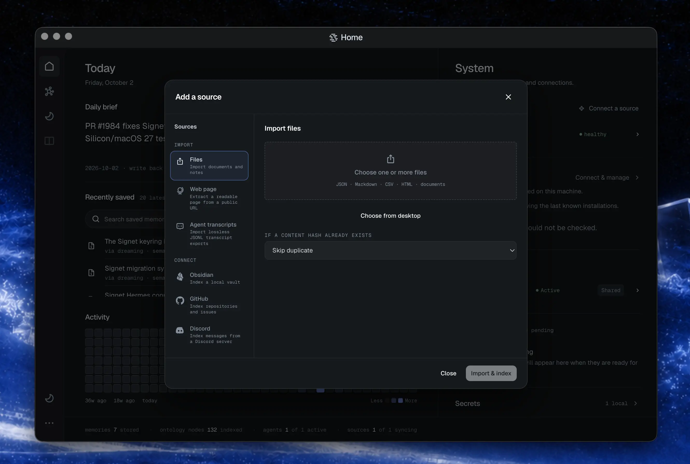
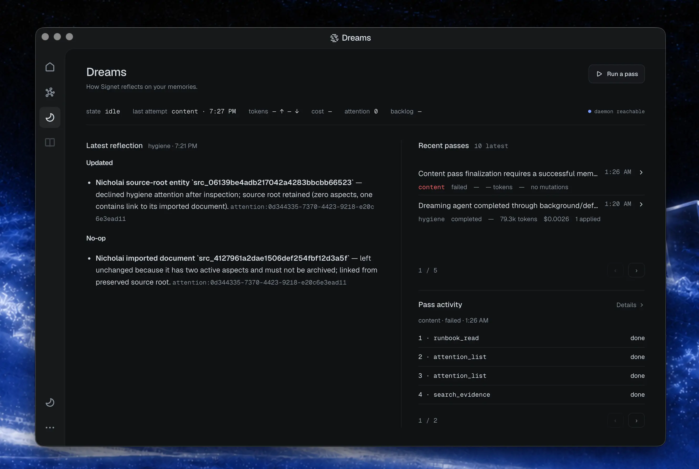
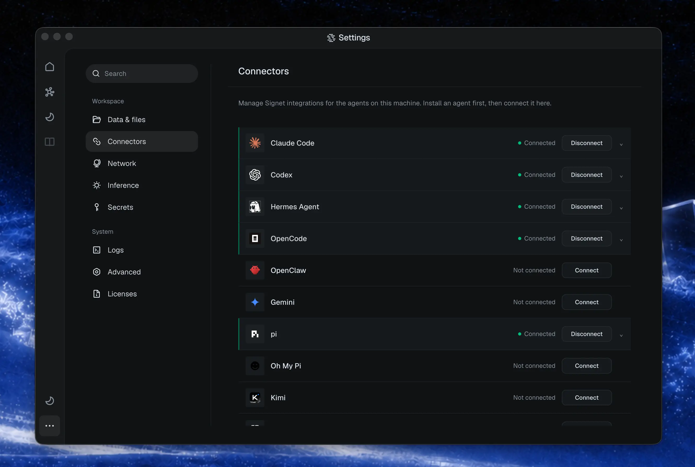
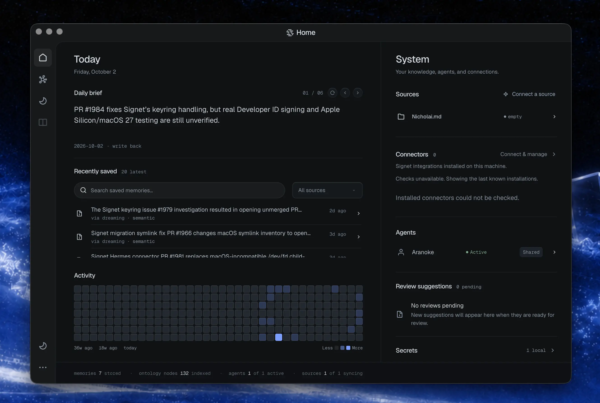
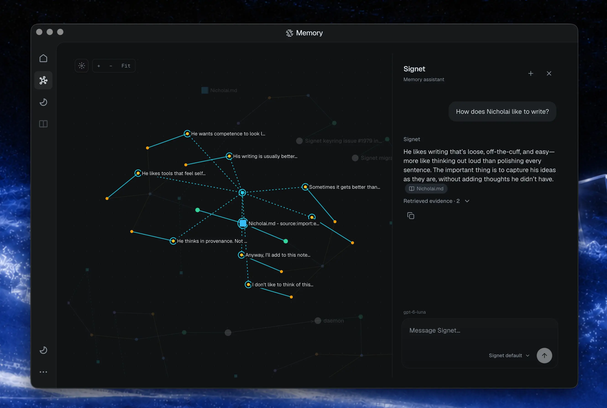
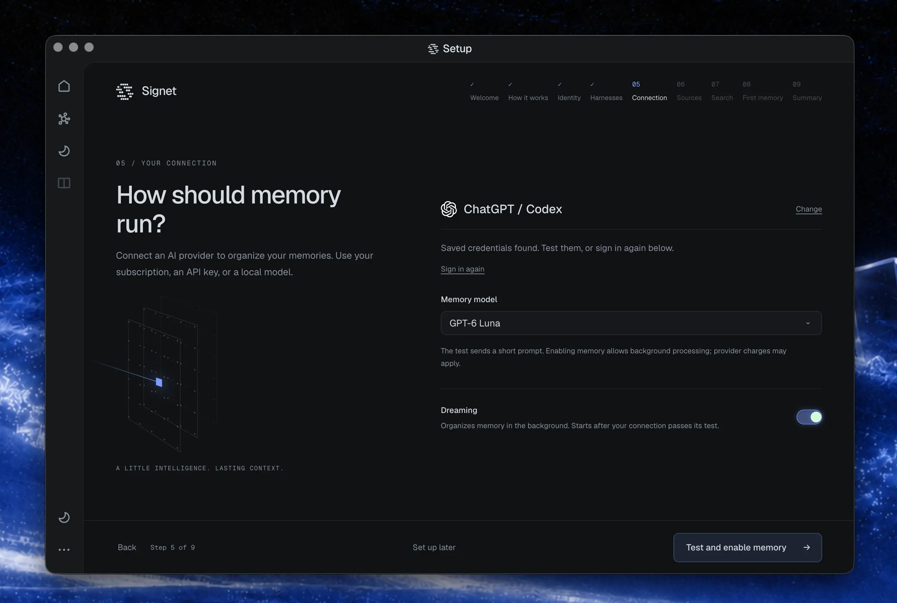
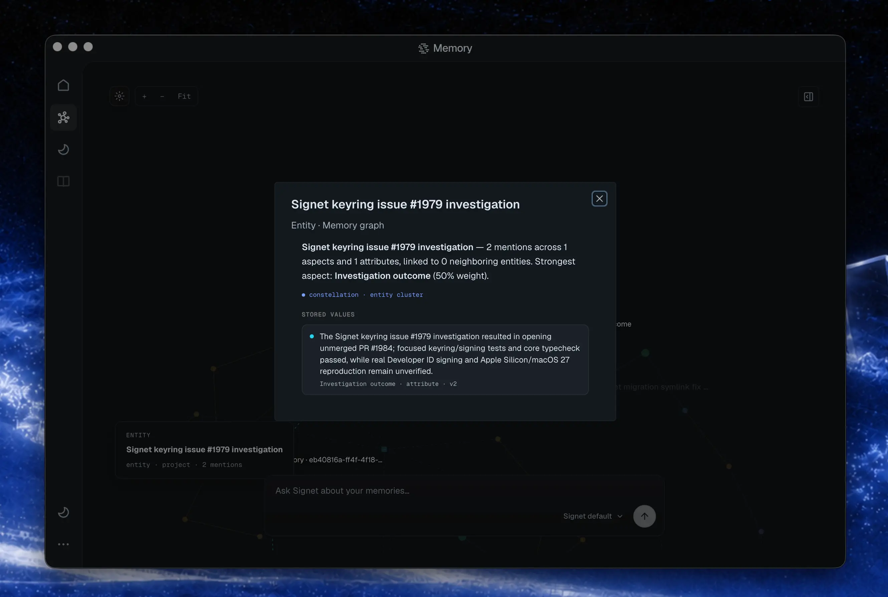
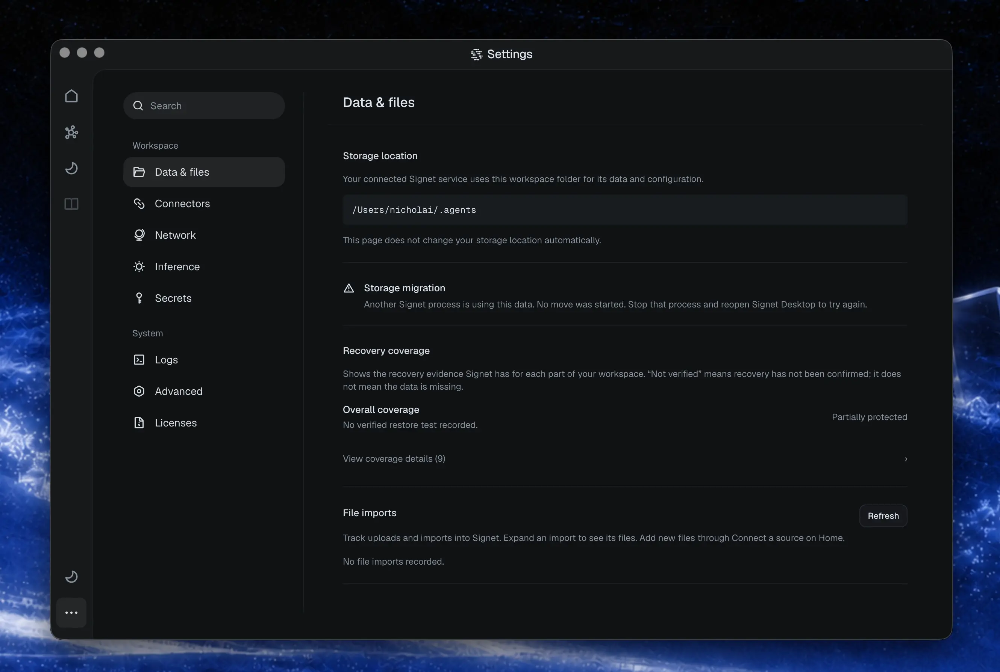

Signet is 1.0.

Today `v1.0.0` goes out on the stable release channel, carrying more than 2,800 commits since our last stable release.

When we started on Signet about nine months ago, we mostly imagined a memory server that organizations would deploy and share. In practice, most of the people actually using it are individual developers and other AI power users. That’s been helpful for clarifying what we want Signet to be: memory that you can run yourself, understand, and keep using as the rest of your tooling changes.

You might code with one model, do research with another, and switch between agent tools depending on the job. In each case you’d like the context you’ve accumulated to remain useful. Signet should give you that continuity, while letting you see clearly what it remembers and how that’s changing over time.

That’s the direction we’re trying to push with this release: making it easy to get that experience, whether you’re running Signet on your laptop or hosting it for an organization. You should be able to use it like any other app, inspect your memory in the dashboard, and grow into a larger deployment when that’s what you want.

The biggest changes in this release are about making Signet easier to use day to day. That mostly means making memory easier to maintain, inspect, and actually bring into your work:

- **Dreaming** replaces the old extraction pipeline with an agentic loop that maintains your memory and ontology.
- Agents can work together through Signet, with direct messages that reach idle sessions and a shared message board.
- Recall is more accurate, with a local reranker, stemmed keyword search, and excerpts from the original conversation when they help.
- We now have official Windows support and a cross-platform desktop experience.
- Setup is guided, and there are new ways to bring conversations and documents into Signet.
- Memory is easier to inspect, with clearer provenance, revision history, and review state.

> **Upgrading an existing workspace?** This release moves your workspace to the new Workspace v2 layout automatically the first time the new daemon starts. Back up first, and see **Installing and updating** below. If you installed with the native installer on Linux or Windows, rerun the installer instead of `signet update install`.

## Sources and Dreaming: bringing your context together


**Sources** are how the context you already have gets into Signet: notes, project documents, Notion pages, agent conversations, and so on. You can connect an Obsidian vault or Notion workspace during onboarding, so your agents start with useful context from your existing work. You can also bring in webpages, PDFs, Office documents, and EPUBs as one-time imports, without setting up an ongoing connection.



Conversation imports preserve who said what, when, and where it came from. They can resume after an interruption, and importing the same conversation again won’t duplicate its evidence. You can also export conversations as structured JSONL for analysis, fine-tuning preparation, or re-import, choosing which agents and dates to include. That context is yours to take with you.

Signet makes all of this material searchable and connects the people, projects, facts, and relationships it describes. That forms a semantic ontology: a shared representation of what your sources are about and how they relate. A project note, an updated Notion page, and an agent conversation can together explain a decision and how it changed, with references back to the supporting material.

**Dreaming** is responsible for maintaining that knowledge as your work evolves. It examines new evidence alongside existing context, consolidates related information, revisits contradictions, and proposes updates to claims. Changes are validated and recorded with citations; the original evidence stays intact. Rather than treating each new memory as an isolated extraction job, Dreaming works through a body of connected evidence.

Claims also carry real-world time: when an event happened, or the period a fact held true, kept separate from when Signet learned about it. Claims that will change, like a deadline or someone’s current role, can be scheduled for review so Dreaming comes back to them later.

Dreaming runs passes for separate agents in parallel, and it works with local models. Point it at any OpenAI-compatible server, then set the thinking budget, context window, and timeout to fit your model.

You can follow that work in the dashboard through live traces, pass summaries, and an operation ledger. This release also improves recovery from interrupted work and stalled triggers, prevents duplicate pass creation, and keeps passes within their budgets on large backlogs.



Read more about [connecting and importing sources](https://docs.signetai.sh/sources/), [transcript import and export](https://docs.signetai.sh/cli/data-portability/), and [Dreaming and ontology maintenance](https://docs.signetai.sh/pipeline/extraction-decisions/).

## Your context, across your agents

Sources bring your existing work into Signet. Harness integrations bring that context into the agents you use, and capture new context as you work. (A harness is the app or environment your agent runs in.) Signet connects through a harness’s supported hooks, extensions, and plugins to supply relevant memory in the background, without making you paste the same context into every session.



We maintain integrations for Claude Code, Codex, OpenCode, OpenClaw, Hermes Agent, Pi, Oh My Pi, Kimi Code, and Muse Code. They connect your sessions to a shared memory, so switching between agents can carry forward the decisions, preferences, and project knowledge you’ve already built up. What each integration can do depends on its host: session context, conversation capture, and on-demand memory tools where the host supports them.

This release expands that support:

- ChatGPT desktop connects through Signet’s native Codex plugin, with discovery and setup on macOS, Windows, and the Linux preview. It supports Work/Codex mode.
- Kimi Code joins the supported harnesses with lifecycle hooks, MCP tools, and support for background inference through ACPX.
- Muse Code joins on macOS and Linux, with hooks and MCP tools.
- Hermes’s curated native memory now participates in Signet recall, with provenance. Edits and removals are reflected in recall while the original memory files remain under Hermes’s control.

See the [harness integration guides](https://docs.signetai.sh/harnesses/), including [Codex and ChatGPT desktop](https://docs.signetai.sh/harnesses/codex/), [Kimi Code](https://docs.signetai.sh/harnesses/kimi/), [Muse Code](https://docs.signetai.sh/harnesses/muse-code/), and [Hermes Agent](https://docs.signetai.sh/harnesses/hermes-agent/).

## Agents that work together

If you run more than one agent at a time, they can now coordinate through Signet instead of through you.

- **Direct messages** reach the agent they’re addressed to. Claude Code, Hermes Agent, and Pi sessions wake up for a message even when they’re idle. Codex picks it up when its current turn ends, and other harnesses see it at their next prompt. Messages survive restarts and stay unread until the recipient acknowledges them, or until they expire after seven days.
- **The message board** holds topic threads for things more than one session should see: decisions, status, and questions anyone can pick up. Board posts don’t expire and never wake anyone, and Dreaming can use them as evidence.
- **Peer context** shows which other sessions are active and what they’re working on, including their task, working directory, and recently changed files, so an agent can pick the right session to talk to.

Hermes Agent and Pi get these as native tools; most other harnesses use them through Signet’s MCP tools. Each session also learns at startup who it is and how to reach the others. See [direct messages](https://docs.signetai.sh/hooks/#direct-message-wake) and [the message board](https://docs.signetai.sh/board/).

## Better recall

Recall got a lot of attention in the last stretch before 1.0:

- A local cross-encoder reranks the top candidates by reading your question against each memory, so a relevant memory can surface even when it shares no words with the question. It’s on by default; the model is about 90 MB and downloads on first use.
- Keyword search matches word stems, so a search for “deploying” also finds “deployed”.
- When Dreaming hasn’t filed a detail as a memory, recall can return a short excerpt from the original conversation instead, limited to what the requesting agent is allowed to read.
- Keyword and vector results are combined by rank rather than raw score, and the strongest semantic matches keep their place among the candidates.
- `signet accelerate` installs a native runtime for embeddings and reranking, which runs the reranker several times faster than the default WebAssembly runtime. On Linux with an NVIDIA GPU, `signet accelerate cuda` runs the reranker on the GPU.

Read more about [how recall works](https://docs.signetai.sh/memory/).

## At home on your desktop



Signet is designed for both server and desktop use. You can run it as a server for yourself or an organization, or use it like any other app on your computer. Install Signet normally, then add the optional desktop app with `signet desktop install`. It’s available on macOS, Linux, and Windows x64.

We’ve redesigned the dashboard around what you actually do there: look through your memory, connect sources and agents, change settings, and watch Signet work. The redesigned dashboard is available in your browser too, giving you the same controls whichever way you access it.

The dashboard also has a new memory graph, a 2D map of the people, projects, and claims Signet knows about and how they connect, for all of your agents or one at a time. Next to it is a chat where you can ask questions of your memory using any connected model that supports tools. Answers cite the memories they draw on, and from the same chat you can ask Signet to remember something or have Dreaming review it.



A new Skills library shows the skills your agents can use and their instructions. If you run Signet for a team, the dashboard now has a proper sign-in screen, and admins can create and revoke API keys from settings.

Getting started now happens there as well. Guided onboarding walks you through choosing a provider and connecting your sources and agents in the dashboard or desktop app, replacing the old terminal questionnaire. Non-interactive CLI setup remains available for headless installations, or if you’d rather have an agent handle setup for you.



## Other improvements

- Agent isolation: each agent only recalls memory it’s allowed to read.
- Secret storage: the master encryption key now lives in your OS keyring, and secrets stay encrypted on disk. Systems without a keyring fall back to encrypted file storage and show a health warning.
- Status and diagnostics: connector readiness, workspace statistics, queues, and Dreaming state now share a consistent view across the CLI and dashboard. Provider, model, embedding, and inference routes are inspectable in [dashboard settings](https://docs.signetai.sh/dashboard/).
- Workspace v2: a clearer layout separates authored files, durable data, transcripts, runtime state, and caches. Existing workspaces move to it in place on first start and keep their source identities and evidence links. Skills can use their own Git repository.
- File inbox: manual file drops and dashboard uploads share a durable import path. Files already in the inbox are not automatically imported during setup or upgrade.
- Protection status: see which parts of your workspace are protected, with missing or stale backups flagged. Git sync on its own doesn’t cover your whole workspace.
- Transparent memory: recall shows where each memory came from, how it’s changed, and whether it’s been reviewed.

  
- Credentials that look like known secrets, such as API keys, are redacted from what your agents see. You can also ask why Signet believes something: a claim trace returns its history, competing claims, and the exact source passages behind it, from the CLI, API, or MCP.
- Recall and search: fixed scope and filter bugs, fewer duplicate session results, caps on expensive searches, and resumable rebuilds when the full-text index is damaged.
- Dreaming and embedding recovery: fixed stuck triggers and duplicate passes, and improved recovery from interrupted embedding migrations and provider failures.
- Sources and transcripts: improved interrupted-import recovery, serialized conflicting source changes, made deletion resumable, and preserved transcript provenance through upgrades and backfill. When the daemon is busy, transcript capture returns an error the harness can retry instead of silently dropping the transcript.
- Server reliability: continued moving database work behind the database-owner service, with bounded startup, shutdown, and background work, better cancellation, and recovery from service failures. Background work backs off when your machine is busy, and the daemon recovers on its own from crash loops.
- Desktop and packaging: fixed packaged-daemon startup, missing connector assets, Windows shell and path handling, macOS window controls, and managed AppImage updates.
- Documentation: a new docs site at [docs.signetai.sh](https://docs.signetai.sh/) covers setup, harnesses, Dreaming, and the API in one place.

Details are recorded in the [release changelog](https://github.com/Signet-AI/signetai/blob/v1.0.0/CHANGELOG.md).

## Telemetry

Signet asks before it sends anything. Setup, `signet update install`, and the dashboard each ask once whether to share anonymous usage data, and nothing is collected until you say yes. That includes existing workspaces: if you never set a preference, Signet asks the first time you update or open the dashboard.

If you say yes, Signet sends install and version counts, which features get used, token and cost totals per provider, and sanitized crash reports. It never sends memory content, prompts, search queries, or anything that identifies you personally; events carry a random install ID. Every event is also written to a local log at `runtime/telemetry/events.jsonl` in your workspace, so you can read exactly what was recorded.

The npm package also sends one anonymous install count, version and platform only, when it installs; set `SIGNET_TELEMETRY_OPTOUT=1` before installing to skip it. Change your answer any time with `signet telemetry on` or `signet telemetry off`, or in Settings → Advanced. Details are in [telemetry controls](https://docs.signetai.sh/analytics/).

## Installing and updating

Choose **one** installation method. The native installers and the npm/Bun packages install the same compiled Signet binary.

### Native installer — macOS and Linux

```bash
curl -fsSL https://signetai.sh/install.sh | bash
```

### Native installer — Windows x64

Run in PowerShell:

```powershell
iwr -useb https://signetai.sh/install.ps1 | iex
```

Open a new PowerShell window after installation so the updated PATH is available.

### npm — Windows, macOS, and Linux

```bash
npm install -g signetai
```

### Bun — Windows, macOS, and Linux

```bash
bun add -g signetai
```

For a new installation, run `signet setup` after installing. See the [installation guide](https://docs.signetai.sh/getting-started/install/) for platform details.

### Update an existing installation

```bash
signet update channel stable
signet update install
```

`signet update channel stable` moves you to the stable track; `signet update install` installs the latest stable release. Auto-update doesn't install a new major version, so existing installs, including nightly ones, need this step once to reach 1.0. Follow any restart instructions printed by the updater, then check `signet status`. See [upgrading](https://docs.signetai.sh/upgrading/) for details.

**If you used the native installer on Linux or Windows,** `signet update install` from `v0.157.3` (or any release before `v0.235.1`) will stop with:

```
✖ Native manifest linux-x64 asset entry failed URL, checksum, or size validation
```

Nothing is wrong with the download. The older updater rejects binaries larger than 256 MiB, and the Linux and Windows 1.0 binaries are larger than that. Run the native installer for your platform from above instead; it replaces the binary, and the new daemon upgrades your workspace when it starts. Then run `signet daemon restart`. npm and Bun installs update through the package manager and aren't affected. Updaters from `v0.235.1` on accept the larger binaries, so this is a one-time step.

### Upgrading an existing workspace

Back up your workspace first. The first time the 1.0 daemon starts, it moves an existing workspace to the Workspace v2 layout in place: the database, transcripts, caches, and runtime state move into their new folders under the same workspace root, while your notes, identity files, `agent.yaml`, skills, and secrets stay where they are. Check the result with `signet status`.

If an older daemon is still running, the upgrade waits until it stops. If something blocks the upgrade, such as a file already in the way, Signet undoes the moves it made, starts on the old layout, and `signet status` tells you what to fix; fix it and restart. Once a workspace has upgraded, don’t run older Signet versions against it.

**Turn on Dreaming after upgrading.** Dreaming replaces the old extraction pipeline, which no longer runs. In an upgraded workspace that has no Dreaming setting, Dreaming is off, so Signet writes no new memories until you set `memory.dreaming.enabled: true` in `agent.yaml`. It also needs a working inference provider. New installs turn it on during setup.

See the [Workspace v2 guide](https://docs.signetai.sh/workspace-v2/) for the full list of moves and recovery steps.



**Secret recovery also depends on the keyring.** After secrets migrate to keyring-backed storage, a workspace backup alone is not enough to recover them. Preserve the corresponding platform keychain as part of your recovery plan; see [secret storage and recovery](https://docs.signetai.sh/secrets/).

## Releases from here

Until now, stable releases were rare and most changes shipped as nightly builds, which is how the version number climbed to 0.240. From 1.0 on, we’ll ship stable releases regularly, numbered with semantic versioning: patch releases for fixes, minor releases for new features, and a major release only when something breaks compatibility.

We’re pausing nightly builds. If you’re on the nightly channel, you’ll move to 1.0.0 and receive each stable release after it without changing anything.

## Since the previous stable release

Since `v0.157.3`, this release includes **2,852 commits across 2,714 changed files**, with **339,147 lines added** and **194,303 lines removed**.

> Comparison range: `v0.157.3..v1.0.0`  
> Previous stable: `v0.157.3`  
> New stable: `v1.0.0`

Full version-by-version history: [CHANGELOG.md](https://github.com/Signet-AI/signetai/blob/main/CHANGELOG.md).

## Contributors

Thank you to [everyone who has helped build Signet](https://github.com/Signet-AI/signetai/blob/v1.0.0/README.md#contributors):

Nicholai Vogel (@NicholaiVogel), Avery Felts (@aaf2tbz), @Ostico, @BusyBee3333, @stephenwoska2-cpu, @PatchyToes, @ddasgupta4, @LeuciRemi, @nyashkn, @Alexi5000, @dragontvstaff, @maximhar, @alcar2364, @noamsiegel, @lost-orchard, @gpzack, @Jarvis-ORC-HPS, @nanookclaw, @quannon, @arnavgoel17, @glen-tl, and @mikemikimike.

Thank you to everyone who tested the development releases, reported problems, and helped us get here.
